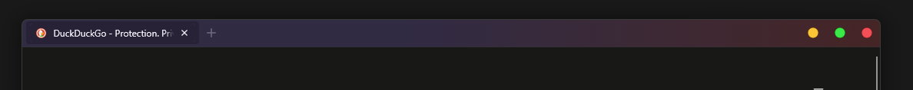
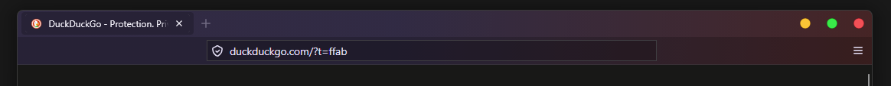

# Firefox Compact

A compact `userChrome.css` for Firefox with tabs in the style of
[Darkly](https://github.com/Bali10050/darkly-firefox) and an address bar that hides until you need it.

**Address bar hidden**

**Address bar shown on hover**

## Features

- **Darkly-style tabs, smaller.** Tabs sit in one dark strip, each tab is a pill inside it, and the selected tab is the brightest pill.
- **Auto-hide address bar.** It folds away and opens after you hover the tab bar for 1 s, so moving the mouse across it doesn't trigger it. `Ctrl+L` / `F6` / `Alt+D` or opening one of its menus shows it instantly. It hides again 0.3 s after you move away.
- **Accent hover.** Inactive tabs get a tint of your system accent colour on hover.
- **Container tabs** colour their pill instead of showing a line.
- **Square menus and panels** with tighter spacing.
- **Less clutter:** back/forward buttons, the bookmark star, translations and taskbar-tab buttons and the window buttons in the tab bar are hidden.

### Window buttons

This CSS hides Firefox's own minimize / maximize / close buttons.
The coloured dots in the screenshots replace them. They come from three Firefox add-ons, which put a button in the toolbar:

- **OS style Close Window Button**
- **OS style Maximize Window Button**
- **OS style Minimize Window Button**

Install them from [addons.mozilla.org](https://addons.mozilla.org/firefox/search/?q=OS%20style%20Window%20Button), then right-click the tab bar → **Customize Toolbar…** and drag the three buttons to the end of the tab bar.

## Installation

1. Open `about:config` and set `toolkit.legacyUserProfileCustomizations.stylesheets` to `true`.
2. Open `about:profiles` and click **Open Folder** next to *Root Directory* of the profile in use.
3. Copy the `chrome` folder from this repo into that profile folder.
   If a `chrome` folder already exists, back up your own `userChrome.css` first.
4. Restart Firefox completely.

## Customizing

All tab sizes are variables at the top of `chrome/userChrome.css`:

| Variable | Default | What it does |
|---|---|---|
| `--dk-tab-height` | `30px` | Height of the dark tab strip |
| `--dk-pill-height` | `24px` | Height of each tab pill |
| `--dk-strip-radius` | `4px` | Rounding of the strip's ends |
| `--dk-pill-radius` | `3px` | Rounding of the pills |
| `--dk-tab-gap` | `10px` | Space between pills |

Keep the strip at least 4px taller than the pill so the strip stays visible around it.
Pill brightness is set by the `currentColor 11%` (inactive) and `currentColor 22%` (selected) values.

## Credits

Tab design based on [Darkly for Firefox](https://github.com/Bali10050/darkly-firefox) by Bali10050.

## License

GPL-2.0, the same license as Darkly. See [LICENSE](LICENSE).
